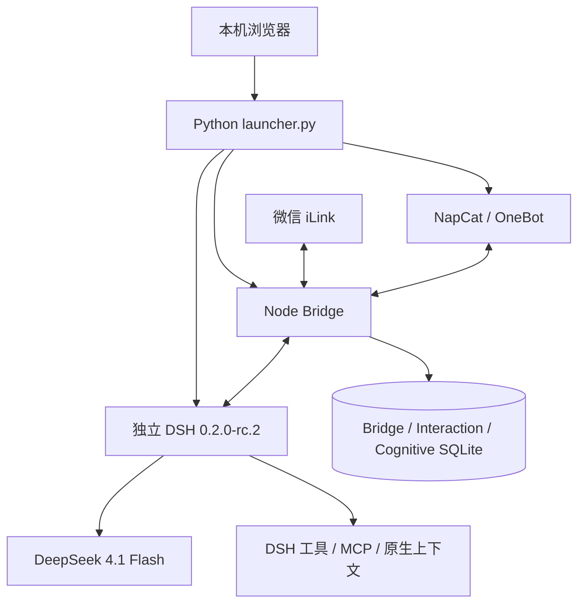

# 架构说明 · v1.8.2

这是实际实现的代码地图。DSH 是唯一 Agent Runtime，本扩展不直接调用独立模型后端、不另建 MCP 或工具执行框架。

## 进程和模块

Python 启动器提供本机认证的 HTTP 控制台，以 IPC 管理自己创建的子进程，不按端口结束工作 DSH。独立 DSH 使用官方 launch-token 交换 Cookie，不读取签名密钥、不离线生成 Cookie。

| 位置 | 职责 |
| --- | --- |
| `launcher.py`、`web/` | 服务、二维码、认证、分页控制台 |
| `src/main.js`、`engine.js` | 队列、DSH 提交、事件协调、审批/澄清、公开输出与 outbox |
| `src/ilink.js`、`media.js` | 官方 iLink、长轮询、发送、受限图片传输 |
| `src/qq.js`、`qq-forward.js`、`qq-media.js` | OneBot、好友/群目标、转发、图片与收藏 |
| `src/dsh.js` | `/api/<namespace>/<method>` RPC、`/api/remote.mux` 订阅 |
| `src/store.js`、`runtime.js`、`contacts.js` | 持久化、Session、交互状态、来源、收件人 |
| `src/cognitive/` | Self/记忆存储、检索、后台任务、证据验证、删除与投影 |
| `dsh/*.js`、`weixin.patch.yml` | 原生 Preset、guard、Prompt section/context、工具注册 |
| `scripts/` | 独立依赖、归档、测试与分发 |

## 消息链路

微信游标与入站任务同事务保存；QQ 按原生消息 ID 和群号去重。每条任务固定账号、真实作者、Session 与 requestId，昵称或转发声明不改变身份。准备文字/图片后调用 DSH `session/prompt`，订阅原 Session 事件，不因超时偷偷创建替代会话。

所有渠道进入 WebUI 选定的一个正式 Session。普通正文仅在当前公开回复阶段进入候选队列；显式发送支持一轮多次，避免自动重复。reasoning、private_note、自主继续阶段及内部闹钟正文保留本机，主动外发通过已授权目标。emissions 持久化后进入 outbox；结果不明进入 unknown。准备失败未入 DSH 时释放后续任务；提交结果不明保留 review。

## Prompt 的实际角色

| 逻辑层 | 实际装配 |
| --- | --- |
| P0 | DSH 原生规则与替换后的 CORE；权限由工具 guard 执行 |
| P1 | 动态、描述性的 Self system section，与 P0 合并为一个 system 消息 |
| P2 | 有预算的记忆、目标与当前对象，DSH user-role context 快照 |
| P3 | 带来源的用户消息、引用和外部数据 |

section 每次装配求值，Self 新版本无需重建 Session。顺序约定不是独立的模型权限角色。原始 SYS 备份与 v0.1.0 Self 分别保存。

## 数据和后台任务

- `data/bridge.sqlite`：任务、事件投影、正式/测试 Session、双方聊天、审批、outbox。
- `data/interaction.sqlite`：输出意图、回复路由、私有思考、闹钟、联系人和控制台设置。
- `data/cognitive/cognitive.sqlite`：统一 Self、五类记忆、来源、版本、提案、日记、目标与后台收据。Markdown 是可重建投影。
- `.runtime/home/sessions/`：DSH 原生多帧 Zstandard 上下文；`data/media/`、DSH attachments 保存媒体；小房间在 `data/cognitive/room/`。

全局空闲 15 分钟后独立 worker 提取经历，夜间 Dreaming 巩固/关联/纠正和可选反思。任务固定输入快照与水位，有重试及收据，不重置正式 Session。Self 更新检查证据、范围和版本冲突，允许 no-op，不触及 Core/权限。检索结合 FTS5、词项哈希向量、时间、实体/关系和目标；当前不是外部 embedding 模型或图数据库。

## 一致性与迁移

单库事务不是跨 Bridge、认知库、DSH 和平台的分布式事务。固定 ID、收据和恢复减少重复，不宣称严格 Exactly Once。统一记忆的披露依赖模型；账号身份、群白名单、工具和传输限制由代码执行。

DSF 是离线回滚格式，朋友 ZIP 是保留状态的开发交流快照。后者剥离授权，不替代认证迁移。原部署绝对路径及 Session 桶名可能保留，换路径后的媒体、上下文恢复须核对，不承诺直接搬机即可完整续跑。
